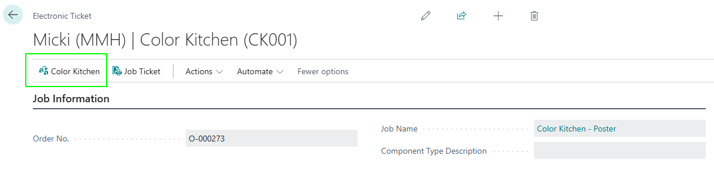
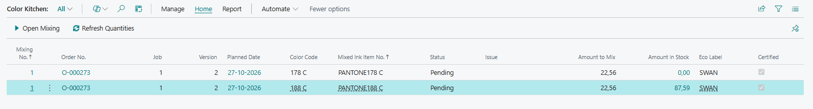
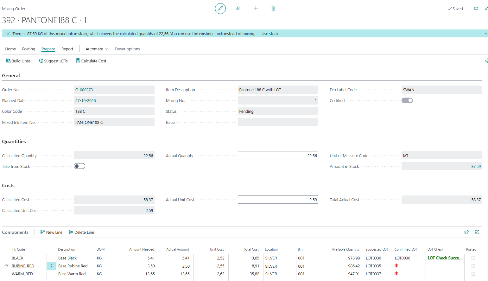
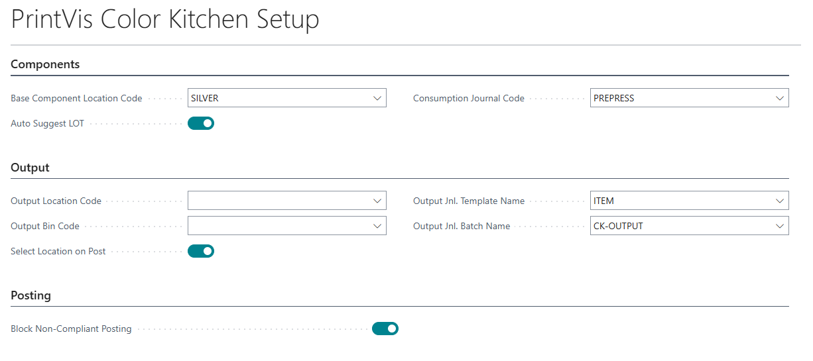
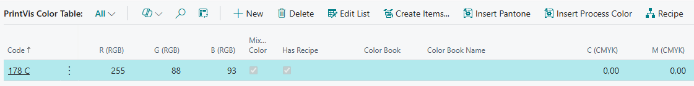
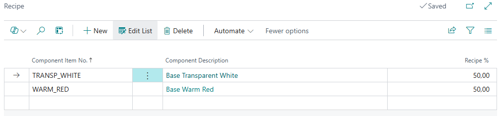
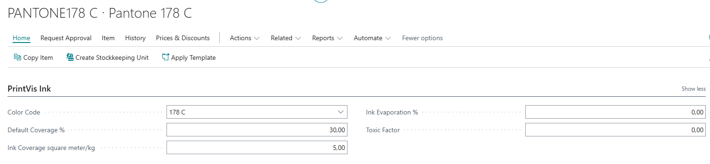
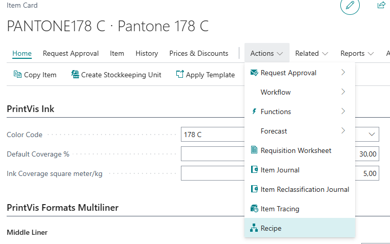
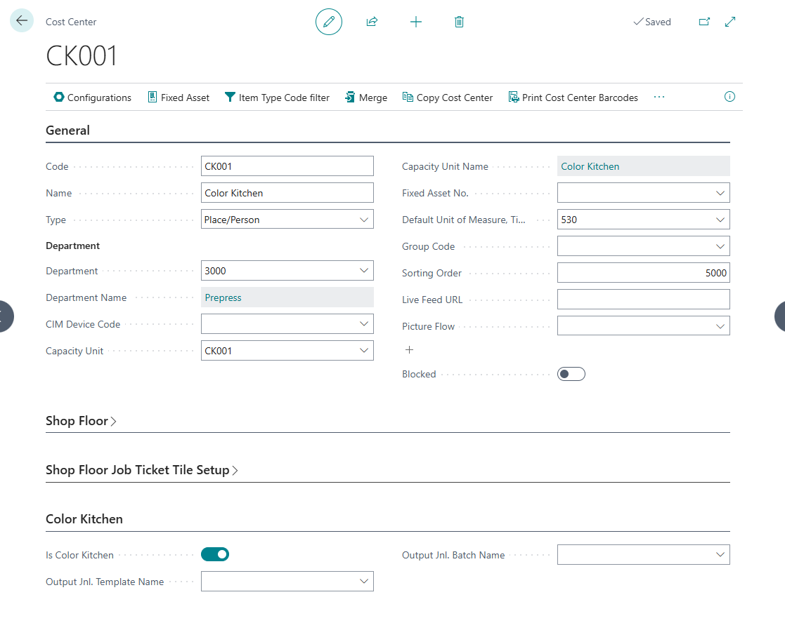
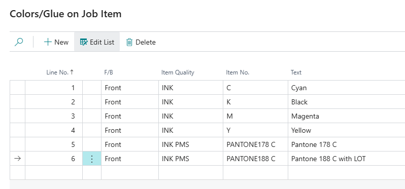

# Color Kitchen

## Overview

The Color Kitchen app will manage Mixed Ink Recipes and track Base Component consumption in Mixed Ink production through LOT tracking in PrintVis. And ensure compliance with food-safe and eco-label standards that are already handled by the printvis Eco label setup. 

## Using the Color Kitchen

Access the Color Kitchen through the Electronic Ticket on the shopfloor role center for the Cost Center you setup as a Color Kitchen.

On this page you will get an overview of all the inks that are to be mixed for the job. You can refresh quantities if anything was changed on the job since you started processing mixing jobs. You can also print a Picking List, LOT labels and Ink Trace report from this page.

|  |  |
| --- | --- |
| Open Mixing | Opens the latest mixing card for the selected ink while no ink on the job is posted. When all inks on the job are posted, you will be asked whether to create new mixing sessions for all of them. If only some inks are posted, new mixing cannot start yet. |
| Refresh Quantities | Updates the amount to mix of pending and in-progress mixing orders from the current case calculation. Pending orders whose actual quantity was not changed manually are rescaled as well. |
| LOT Labels | Prints mixed-ink LOT labels for all inks on this job. |
| Picking List | Prints the component picking list for all inks on this job. |
| Ink Trace | Prints the base component breakdown with LOT numbers for all inks in the selected mixing session. |
| Mixing No. | Specifies the sequential number of this mixing session for the ink on this case. Increments each time a new mixing session is created after the previous one is posted. |
| Order No. | Specifies the order number of the PrintVis case this mixing order belongs to. |
| Plan ID | Specifies the PrintVis planning unit ID this mixing order belongs to. |
| Mixed Ink | 	Specifies the BC item number for the mixed ink output. |
| Planned Date | 	Specifies the planned start date of the planning unit this mixing order belongs to. |
| Color Code | 	Specifies the color/ink code from PVS Color Table. |
| Mixed Ink Item No. | 	Specifies the BC item number for the mixed ink output. |
| Status | 	Specifies the current status of the mixing order. |
| Issue | 	Specifies why this ink could not be fully prepared (invalid recipe). Blank when OK. |
| Amount to Mix | 	Specifies the quantity calculated by the PrintVis engine. |
| Amount in Stock | 	Specifies the quantity of this mixed ink currently in inventory. |
| Eco Label | 	Specifies the required eco label / certification code. |
| Certified | 	Specifies whether every recipe component of this mixed ink carries the required eco label. |

### Mixing Order

|  |  |
| --- | --- |
| Use Stock | Allows you to use the existing stock instead of mixing. This will set 0 in Actual Quantity, and 0 in Actual Amount on the Components lines. When posting a Use Stock mixing order, you will be able to transfer Ink from one location to another. |
| Start Mixing | Mark the mixing order as In Progress |
| Finish Mixing | Marks mixing as complete, stamps end time, and recalculate costs. Does not post to journal - use Post afterwards. |
| Post | Creates the mixing ink output line in the output item journal, posts mixing time and material consumption to job costing, then posts the output line. The output item journal must be empty. Only available after Finish Mixing. |
| Suggest LOTs | Automatically suggests LOT numbers for all component lines using FEFO (First Expire First Out) |
| Picking List | Prints the component picking list with LOT numbers, quantities, and bin locations. |
| Print Ink Trace | Prints the LOT traceability of this mixing order for the job ticket: which base components LOTs and quantities went into the mixed ink. Available after posting. |
| Build Lines | Rebuilds mixing order component lines from the recipe of the mixed ink item. |
| Calculate Cost | Recalculates the component cost from mixing lines and updates the Calculated Cost and Unit Cost fields. |
| General | The General section contains basic info about the job. The Certified Boolean specifies whether every recipe component of this mixed ink carries the required eco label. |
| Quantities | The Quantities section contains the Calculated Quantity to be mixed for the job. In the Actual Quantity you can enter the final amount mixed if it is more or less than the calculated amount. |
| Costs | The Costs section specifies the total raw material cost of this mixing order, calculated as the sum of component quantities multiplied by their unit costs. You can use the Actual Unit Cost field if you want to manually assign a new Cost. |
| Components | The Components section shows the bae components needed for the Mixing Order. Amounts and costs are based on the Recipe and the Actual Quantity.  Location is based in the Cost Center. LOT is suggested based on location and FEFO.  You can enter LOT numbers on these lines, and the LOT Check will confirm or show an error. |

### Recipe Management Flow 

- Create Base Components in PrintVis Color Table and create an Item for it. 

- Create Mixed Inks in PrintVis Color Table. Set as Mixed Color and apply a Recipe using Base Components. Then create an Item for it. 

- Select the corresponding Color Code in the PrintVis Ink section on the Mixed Ink Items and Base Component Items. 

- If the used Color Code is a Mixed Color – A new Recipe action is available on the Item to view the Recipe directly on the Mixed Ink Item. 

- To change the Recipe, go to the PrintVis Color Table and change the recipe on the Color Code.

- Define Eco Labels on Mixed Inks and Base Components (food-safe, Swan etc.). 

### Flow for the Color Kitchen Operator 

- Start Production. 

- Open the new Color Kitchen page from the Electronic Ticket.

- Print a Picking List with the Base Components needed. 

- Start Mixing.

- Use Suggest LOT if this is relevant for your production.

- Enter/scan the LOT number/label of the Base Components if using tracking.

- Select the “Use Stock” option if no mixing is needed because of high stock amount.

- Mix the amount needed for the job based on the calculations. Or mix extra to put on stock. Input Actual Quantity mixed.

- Finish Mixing.

- Post - Amount of Mixed Ink is put into stock on the Item, placed in the default location or a location selected when posted, and Base Components are consumed. 
Surplus is put into default location or a location selected when posted.
If “Use Stock” was selected, Ink is transferred to selected location on Post.

- Print a LOT label for the new Mixed Ink. An Ink Trace report can also be printed after posting to track the base components used for the mixing.

- Stop Production/Complete Job. 

## Setup

Here you will set up the base functions of Color Kitchen depending on your needs.	

|  |  |
| --- | --- |
| Base Component Location Code | Specifies the default location code copied onto newly built mixing order lines. Each mixing order line has its own Location Code, which determines where LOT availability is checked and consumed from, and can be overridden per line. |
| Auto Suggest LOT | Specifies whether the system should automatically suggest a LOT number. |
| Consumption Journal Code | Specifies the journal template code used for consumption posting. |
| Output Location Code | Specifies the location code for mixed output storage. |
| Output Bin Code | Specifies the bin at the output location where mixed output is stored. Required when the output location uses bins. Cleared when the output location changes. |
| Select Location on Post | Specifies whether posting a mixing order asks where the mixed ink goes: the output location, a separate location for a surplus above the calculated quantity, and the target location when the order has Take from Stock on. When off, everything is posted to the Output Location Code without asking, and stock pick lines already at that location are not moved. Their LOTs are recorded in the ink trace either way. |
| Output Jnl. Template Name | Specifies the item journal template used to post the mixed ink output. The template must not use Increment Batch Name. A Color Kitchen cost center can override it. Changing the template clears the batch. |
| Output Jnl. Batch Name | Specifies the item journal batch where the mixed ink output line is created and posted. The batch must be empty when a mixing order is posted, and must differ from the item journal batch of the consumption journal. A Color Kitchen cost center can override it. |
| Block Non-Compliant Posting | Specifies whether posting a mixing order is blocked when a recipe component lacks the eco label required by the case. |

On the PrintVis Color Table we now have the option to add a recipe to a Color Code. This Recipe will be transferred to the Item that uses this Color Code in the PrintVis Ink section on the Item Card.

You can select the base component items of the color code and define the percentage values that make up the mixed ink. A check on the values ensures that a Recipe contains 100% base components, to avoid errors.

To use the recipe functionality on the Color Table, you need to set the Color Code as Mixed Color. On the Item you must set the Color Code from the Color Table in the PrintVis Ink section.

A Cost Center can now be set as a Color Kitchen. You can then access the Color Kitchen from the shopfloor electronic ticket, if you are logged into the cost center set as Color Kitchen.  
Our suggestion is to create a dedicated cost center for the Color Kitchen, with its own Calculation Unit, Planning Unit etc. But any Cost Center can be used.  
When a Cost Center is set as the Color Kitchen, it will grab ink information from the Material Requirements on the case and use this to create the mixing orders for the job. 

Color Kitchen Setup is now done. You now have an item with a Recipe and a cost center to use as the Color Kitchen. Add the ink to the job as you would normally do. In this case I am using Pantone 178 C and 188 C for a poster job.

## New Pages

### Color Kitchen Setup

Page PVS CK Color Kitchen Setup (72136000, Card)

Table PVS CK Color Kitchen Setup (72136000)

### Color Kitchen Main Page

Page PVS CK Mixing Work Page (72136012, Card)

Table PVS CK Mixing Order (72136001)

### Color Kitchen Recipe

Page PVS CK Recipe (72136016, List)

Table PVS CK Recipe Line (72136015)

## New Fields on existing Pages

Page PVS Cost Center Card (6010431, Card)

Table PVS Cost Center (6010347)

Field PVS CK Is Color Kitchen (72136000, Boolean)

Page PVS Color Table (6010418, List)

Table PVS Color Table (6010418)

Has Recipe (Boolean)

Page PVS Color Table (6010418, List)

Table PVS Color Table (6010418)

Recipe (Action)

Page Item Card (30, Card)

Table Item (27)

Recipe (Action on Mixed Ink items only)

Page PVS SF Electronic Ticket (6010731, Card)

Table PVS Job Planning Unit (6010323)

Color Kitchen (Action only if Cost Center is set to Color Kitchen)

## New Reports

72136000 - Color Kitchen Picking List - Picking List (RDLC) - Color Kitchen picking list with mixing order lines (A4 landscape).

72136003 - Case Ink Trace - Case Ink Trace (RDLC) - Base component breakdown with LOT numbers per mixed ink for a case, for the job ticket.

72136001 - Mixed Ink LOT Label - LOT Label (RDLC) - Mixed ink LOT label with base-component traceability for thermal printing (102x152 mm).	
